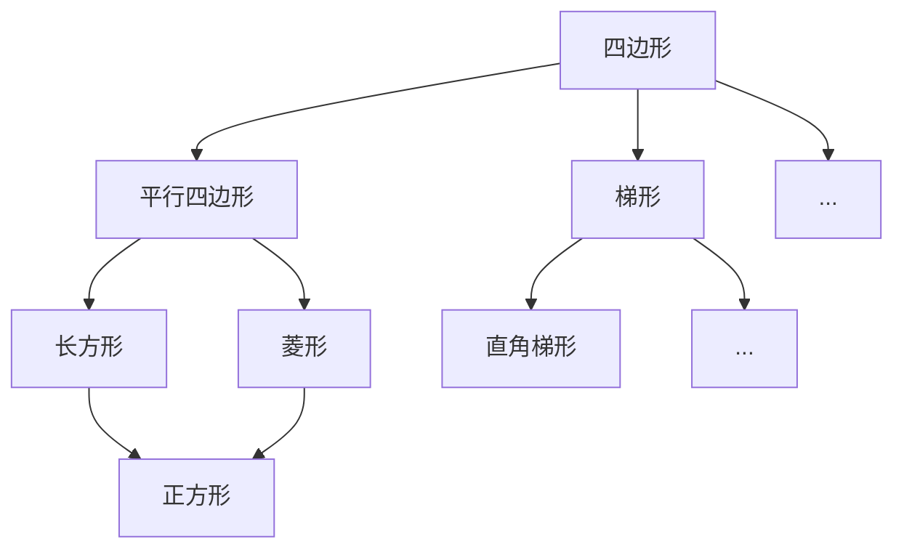

# 几何启蒙

图形可分为平面图形和立体图形。从基本的点、线、角出发，构建平面图形，进而通过“平移”或“旋转”生成立体图形，呈现了从一维到三维的几何认知过程。

- 平面图形：**所有点都在同一平面的图形叫做平面图形**，常见的平面图形有线段、正方形、长方形、圆形、三角形、平行四边形、梯形。**（点动成线、线动成面）**
- 立体图形：**图形上点不在同一平面上的图形叫做立体图形**，常见的立体图形有正方体、长方体、圆柱体、圆锥、球体、棱锥、棱柱。**（面动成体）**

## 1 图形观察-位置与不同的角度

- **位置**：“上”、“下”、“前”、“后”、“左”、“右”。 

**观察的对象是有生命的物体时，一般以生命体本身为标准判断左右。观察的对象是无生命的物体时，一般以观察者的标准判断左右。**

**学会从不同的角度观察同一个物体**，注意立方体的多角度观察，注意观察地基有几个

## 2 图形的位置与运动

图形的位置与运动（平移、旋转、轴对称）。

平移、旋转、轴对称、中心对称

## 3 比较图形的大小和长短

- **比较图形长短时**：在**比较长短**时，可以选择一端对齐进行比较，也可以选择两端对齐进行比较。在两端对不齐的情况下，可以借助尺子、格子、线条等工具进行比较。
- **比较图形大小时**：通过一一对应来比较。某些场景，可以通过平移图形来简化比较，不用一个一个数。

## 4 图形计数

解决**简单的数图形问题**时，可以按1个、2个、3个...分成多个步骤去数，最后将各个步骤的数量加起来。

```text
1. 长方形
   +---+---+
   |   |   |
   +---+---+
   |       |
   +-------+
   (   ) 个长方形

2. 线段
      A    B    C    D    E
      *----*----*----*----*
   (   ) 条线段

3. 三角形
             *
            /|\\
           / | \ \
          /  |  \  \
         /   |   \   \
        *----*----*---*
   (   ) 个三角形
```

解决**数立体图形问题**时，可以通过分层的方式一层一层计算，复杂图形可以用整体减局部的思路得到。

将`4*4*4`的大正方体“中的“L”形挖穿,你能数出现在这个立体图形有多少个小正方体吗?

## 5 平面图形：点、线、角
-   **基本几何元素**：
    -   **点**：没有大小、粗细，仅表示位置。
    -   **直线**：没有端点，向两侧无限延伸。（两点确定一条直线）。
    -   **射线**：只有一个端点，向一个方向无限延伸。
    -   **线段**：有两个端点，指直线上两点及两点之间部分。
-   **角**：
    -   由一个顶点，从该顶点延伸出的两条射线作为边组成。
    -   角的分类（开口大小决定）：锐角（$0^\circ < \angle < 90^\circ$）、直角（$90^\circ$）、钝角（$90^\circ < \angle < 180^\circ$）、平角（$180^\circ$）、周角（$360^\circ$）。
    -   注意直角和锐角一定可以拼成钝角，但两个锐角不一定能拼成钝角。

- 画线段的方法：长度是否精准，端点的小竖线要标上，长度要标上。
- 画角的方法：画角时先画顶点，从顶点起向两个方向画两条直线。注意角的顶点是尖的，不是圆弧角的边要化成直线，直角注意做好直角标记。 
- 数角的方法：数角时要有顺序可以做上角的标记，注意组合角（可以参考数图形的方法来数角）。

## 6 平面图形：三角形

按角分类：
- 锐角三角形
- 直角三角形
- 钝角三角形

按边分类：
- 普通三角形
- 等腰三角形
- 等边三角形

三角形边的性质：任意两边之和大于第三边

- **三角形内角和**：三角形内角和为 $180^\circ$，可通过剪切移动拼接成平角证明。示例组合：$<90^\circ, 45^\circ, 45^\circ>$ 与 $<90^\circ, 60^\circ, 30^\circ>$。

- n边形内角和：(n-2)*180


- 观察三角尺：一副三角尺有两把，每把三角尺有一个直角和两个锐角，两把尺子的角度分别是90°、45°、45°和90°、60°、30°。用一副三角尺可以拼出钝角、锐角、平角，但不能拼出直角。用两副三角尺可以拼出直角。

## 7 平面图形：四边形
-   **四边形分类与特性**：
    -   **平行四边形**：两组对边平行且相等（$\Rightarrow$ 对角相等）。
    -   **长方形**：有一个直角的平行四边形（$\Rightarrow$ 四个角均为 $90^\circ$）。
    -   **菱形**：邻边相等的平行四边形。
    -   **正方形**：邻边相等的长方形（或有一个直角的菱形）。
    -   **梯形**：只有一组对边平行的四边形。



## 8 常见的立体图形
-   **形成方式**：平面图形通过平移或旋转得到立体图形。
-   **图形特征及顶点、棱、面（平面/曲面）统计**：


| 立体图形           | 可由何种平面图形运动形成 | 运动方式                                                             | 备注                     | 棱数    | 平面    | 曲面  | 顶点  |
| -------------- | ------------ | ---------------------------------------------------------------- | ---------------------- | :---- | :---- | :-- | :-- |
| **正方体**​       | 正方形          | **平移**：正方形沿与其垂直的方向平移**等于其边长**的距离。                                | 确保平移距离等于边长，才能形成正方体。    | 4+4+4 | 1+4+1 | 0   | 4+4 |
| **长方体**​       | 长方形          | **平移**：长方形沿与其垂直的方向平移**任意一段**距离。                                  | 正方体可以看作长方体加上限定条件的特殊情况。 | 4+4+4 | 1+4+1 | 0   | 4+4 |
| **圆柱体**​       | 长方形 / 圆形     | **旋转**：长方形以其**一条边**为轴旋转360度。  <br>**平移**：圆形沿与圆面**垂直**的方向平移一段距离。  | 两种方式均可。旋转方式更常见于教学演示。   | 无     | 1+1   | 1   | 0   |
| **圆锥体**​       | 直角三角形        | **旋转**：直角三角形以其**一条直角边**为轴旋转360度。                                 | 圆锥体**不能**通过平移方式直接得到。   | 无     | 1     | 1   | 1   |
| **球体**​        | 半圆 / 圆形      | **旋转**：半圆以其**直径**为轴旋转360度。  <br>**旋转**：圆形以其**直径**为轴旋转180度也可形成球体。 | 这是典型的旋转生成方式。           | 无     | 0     | 1   | 0   |
| **棱柱**​ (如三棱柱) | 多边形（如三角形）    | **平移**：多边形（底面）沿与其平面**垂直**的方向平移一段距离，轨迹形成棱柱。                       | 通常被看作是多边形底面平移的轨迹。      | n+n+n | 1+n+1 | 0   | n+n |
| **棱锥**​ (如四棱锥) | 多边形（如四边形）    | **平移+收缩**：多边形垂直于平面平移并收缩至一点。                                      | 通常不被描述为单一平面图形的简单平移或旋转。 | n+n   | 1+n   | 0   | n+1 |

## 9 正方体的展开

- 不能折成正方体盒子的常见情况：一条线，不过4；凹田7，应舍弃。（这里的7指所有面摆放成7的形状）。

## 10 平面图形的面积

-   **周长公式**（绕封闭图形一周的长度）：
    -   长方形周长 = (长 + 宽) $\times$ 2
    -   正方形周长 = 边长 $\times$ 4
    -   正n边形周长 = 边长 $\times$ n
    -   不规则图形周长求法：①平移法 ②拆分成已知图形 ③整体减局部

## 点到直线的距离与平行线间的距离

- 点到直线的距离：过该点做垂直于直线的线段，线段长度即点到直线的距离
- 平行线间的距离：同一平面中，一条直线如果垂直于一组平行线中的一条，也必定垂直于其他平行线，平行线阶段的垂线段即平行线间的距离。

- 理解梯形、三角形、平行四边形的高
 
## 10 平面图形的面积

-   **面积公式**（物体的表面或封闭图形的大小）：
    -   长方形面积 = 长 $\times$ 宽 （使用单位正方形计算）
    -   正方形面积 = 边长 $\times$ 边长 （使用单位正方形计算）
    -   平行四边形面积 = 底 $\times$ 高 （通过平移可以变成长方形）
    -   三角形面积 = $\frac{1}{2} \times$ 底 $\times$ 高 （一个平行四边形拆分为两个全等三角形）
    -   梯形面积 = $\frac{1}{2} \times$ (上底 + 下底) $\times$ 高 （一个平行四边形拆分为两个全等梯形）
    -   圆面积 = $\pi \times$ 直径² 
    -   **不规则图形求面积**：① 平移法（转化为规则图形） ② 拆分成规则图形 ③割补法，转化为规则图形的加/减） ④整体减局部 ⑤单位正方形计数

-   **面积/体积**：求解不规则图形的面积/体积往往采用“拆分”或“平移”法（与图2关联）。

## 11 立体图形的体积

- 体积：物体所占空间的大小叫作物体的体积。

常用体积单位
- 立方厘米（cm³）：棱长1厘米的正方体体积，如一颗蚕豆。
- 立方分米（dm³）：棱长1分米的正方体体积，如一个粉笔盒。
- 立方米（m³）：棱长1米的正方体体积，如洗衣机包装箱。

基本公式
长方体体积：V = 长 × 宽 × 高 （V = abh）

正方体体积：V = 棱长 × 棱长 × 棱长 （V = a³）

2. 通用公式
体积 = 底面积 × 高
V = Sh
这一公式后来也能用于推导圆柱的体积。

1. 圆柱体积
圆柱体积 V = 底面积 × 高 = πr²h
推导思路是把圆柱切拼成近似的长方体。

2. 圆锥体积
圆锥体积 V = 1/3 × 底面积 × 高 = 1/3 πr²h
通过等底等高的圆柱与圆锥装水实验得出。